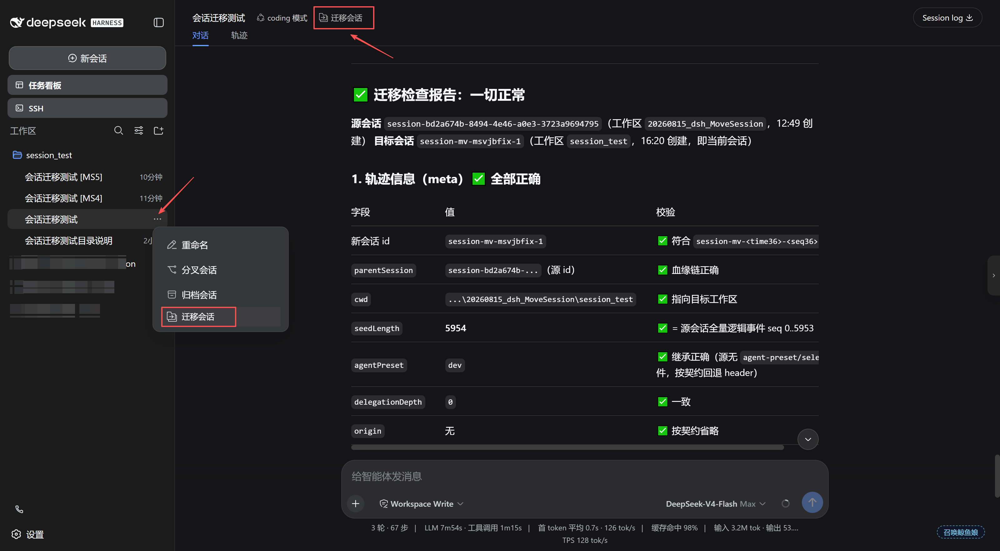

# dsh-move-session

English | [中文](README.md)

Cross-workspace session migration plugin for the dsh Web GUI. Adds a **Move Session** entry to the
session operations: copy the current session **as-is** into another workspace (full conversation
log, title, agent preset and model selection preserved), with a choice to **keep the original** or
**archive the original**. Only **idle** sessions can be moved.

> Current version **v0.1.5**, targeting **DSH 0.2.x** (desktop 0.2.0-rc.2 and later). Same
> hot-pluggable convention as `dsh-ssh` / `dsh-task-board`: mounted via `cordis.patch.yml` + a
> profile `node_modules` install, **no dsh source changes**. Zero-dependency plain JavaScript,
> **source-as-artifact** (`lib/` is the runtime code), no build step.

---

## Features

| Requirement | Implementation |
| --- | --- |
| 1. "Move Session" among session operations | ① **Move Session** button in the session header action row (icon + label, alongside agent preset / subagent catalog / job list); ② a **Move Session** entry in the sidebar session-row "…" menu (the official `sidebar.workspaces.session.menu.item` slot, after rename / fork / archive) |
| 2. Move as-is to another workspace, full context | The complete event log is copied verbatim (messages, tool calls, title, agent-preset/selected, request/header and every other event), recorded as a new session in the target workspace |
| 3. Keep or archive the original | Radio choice in the dialog: `Keep the original session` (default) or `Archive the original session` |
| 4. Proper UI interaction | Icon+label button → modal dialog (target workspace picker + mode picker + error/success states), auto-navigate or offer to open the moved session; all text follows the GUI language (zh/en) |

Other details:

- **Idle-only**: while the session is running the button is disabled and the host re-validates.
- **Cross-tab refresh**: the copy is published via `agents.create` (same path as the shipped fork),
  which pushes `host/session-added`; `attachSession` pushes `host/workspace-changed`; archiving
  pushes `host/archived-sessions-changed` — every tab's sidebar updates instantly.
- **Model & preset inheritance**: `agentOptions` come from the last `request/header` in the source
  log (better than the shipped fork's "current default model"); the agent world is composed from the
  source's preset (last `agent-preset/selected` event, else `header.agentPreset`).
- **Lineage preserved**: the copy header records `isSeeded: true` and `parentSession` = source id,
  and declares the **whole source log** as its inherited prefix (`inheritedEventCount` = source
  event count; the constructor appends one `session/end-seed { inherited: true }` marker at the
  cut) — matching the shipped fork lineage semantics; timestamps and event order are preserved
  byte-for-byte.
- **Session-safe**: the copy gets a fresh id (`session-mv-<time36>-<seq36>`); nothing is
  overwritten or deleted; keep-mode leaves the source untouched.
- **Same-name distinction**: only when the target workspace already holds a session with the
  same title is the copy's title suffixed with **`[MS<n>]`** (e.g. `My session [MS1]`); `n` is one
  above the highest `[MS<n>]` already present there, so repeated moves ascend without colliding and
  re-moving an already-marked copy **replaces** the marker instead of accumulating. No same-name
  means the title stays untouched; untitled sessions are left alone. Clearly different from the
  fork numbering ` (1)` / `（1）`.
- **Empty workspace support**: the move does not depend on the target workspace having any
  sessions — a freshly added workspace is a valid target (its directory must exist).
- **The copy leads its new workspace**: after a successful move the copy is added to the
  registry-global pin set (`workspaceRegistry.pinSession`), so it appears at the **top** of the
  target group (right under the "New Session" row) showing "just now". This is necessary: the
  sidebar's **manual** ordering keeps known members first and appends members it has never seen to
  the **end** — DSH's built-in "a fork child is placed before its parent" rule cannot apply to a
  cross-workspace move, because the source lives in a different group.
  > To leave the target workspace's ordering untouched, add `config.pinOnMove: false` to the row in
  > the profile's patch layer (`- id: move-session`, `name: '@hucj/dsh-move-session'`,
  > `config: { pinOnMove: false }`). Note the pin behaves like a manual pin: it stays in the pin set
  > until you unpin it. Under the default **Last updated** ordering the copy is newest anyway and
  > needs no pin.



---

## Install

> **Desktop (DeepSeek Harness Desktop)**: `desktop` is the application's reserved profile, and the
> source CLI as well as the shipped CLI refuse `dsh plugin --profile desktop ...`
> (`profile "desktop" is managed exclusively by the Electron application`). On the desktop use one
> of the application's own channels: ① the in-app **Settings → Plugins** page, or ② the CLI
> forwarder bundled with the app (Windows:
> `%LOCALAPPDATA%\Programs\DeepSeek Harness\resources\runtime\cli\bin\dsh.cmd`, the same `dsh` the
> "install the command-line tool" action puts on `PATH`): `dsh.cmd plugin --profile desktop add <spec>`.
> Afterwards **fully quit and restart the application** — the `desktop` profile does not hot-reload.

### Option 1: after npm release (recommended)

```bash
dsh plugin --profile web add @hucj/dsh-move-session
```

### Option 2: local path (development)

```bash
git clone git@github.com:hucj09/dsh-move-session.git   # or use the existing source directory
cd dsh-move-session
npm run check     # syntax check + all unit/structural tests (zero build — lib/ is the artifact)
```

Then install:

```bash
dsh plugin --profile web add link:/path/to/dsh-move-session
```

`link:` installs a **symlink**: after changing the source, re-run `npm run check` and restart dsh.
(`file:` installs a one-time copy instead; later source changes are not synced automatically.)

After installing, **restart dsh web** (new bundles only load on next start) and hard-refresh with
**Ctrl+F5**; open any session — the header action row showing the "Move Session" button means the
install succeeded.

> Note: `dsh.client.inject` is empty; the plugin itself declares
> `inject: ['slots', 'sessions', 'locale', 'uiWorkspace']` as hard dependencies, so the host needs
> the standard web runtime (`dsh-client-ui-workspace`, `dsh-client-locale`,
> `dsh-client-ui-conversation`, …, present in the default web and desktop profiles).

## Uninstall

```bash
dsh plugin --profile web remove @hucj/dsh-move-session
```

The command does three things:
1. removes the dependency from `dependencies`
2. removes the bundle row from `dsh.profile.bundles`
3. deletes the `node_modules/@hucj/dsh-move-session` install directory

Then **restart dsh web**.

---

## Usage

1. Open an **idle** session.
2. Click the **Move Session** button in the session header action row (the sidebar session-row
   "…" menu also has a **Move Session** entry).
3. Pick the target workspace (the current workspace is excluded; path and session count shown).
4. Choose what happens to the original:
   - **Keep the original session** (default): the source stays untouched, a full copy is created
     in the target workspace, with an "Open moved session" action;
   - **Archive the original session**: the source enters the archive set (hidden from all grouping
     surfaces; log and accounting retained) and the view navigates to the moved session.
5. The sidebar updates instantly; the copy's messages, tool calls, model and preset match the
   source; the title matches unless the target workspace already holds a same-named session, in
   which case a `[MS<n>]` marker is appended (e.g. `My session [MS1]`).

---

## How it works (brief)

- **Host half** (`lib/index.js`): a loopback-only HTTP route `POST /api/dsh-move-session/move`,
  mirroring the shipped `session.fork` handler step by step: idle check → flush live →
  **`sessionQuery.observeSession` takes one immutable log cut** (live-preferred and cold-safe — the
  same read the shipped fork uses) → target/same-workspace validation → **target directory
  pre-check** (`workspace.status()`; a stale registry entry is rejected before any write) → mint a
  new identity (fresh id + target cwd + lineage) → `agents.create` publishes the copy (`seed` = all
  events, `inheritedEventCount` = event count, `meta.isSeeded: true`; setup composes the source
  preset via `agentPresets.resolve/mount`) → **same-name title suffix** (`sessionQuery` reads the
  target titles, `sessionTitle.rename` appends `[MS<n>]` on collision) → `attachSession`
  accounting → `pinSession` to lead the target group (governed by `config.pinOnMove`, default on;
  a failure never fails the move) → `archiveSession` on request.
- **Browser half** (`lib/client.js`): a standard web plugin bundle registering into three official
  additive slots (`replaceRisk: none`): the `conversation.session.header.actions` button,
  the `sidebar.workspaces.session.menu.item` session-row menu entry, and the `shell.overlay` move
  dialog. The row entry is a **first-class slot occupant** (`order: 500`, right after the shipped
  archive at 400) that dismisses the menu through `useMenuOpenState` — **no DOM injection, no React
  fiber recovery, no CSS class-name dependency**. All three registrations declare `locale: NS`, so
  the framework supplies the `t` seat and the copy follows the GUI language.
- **Log integrity**: migration copies the full log event by event; run
  `npm run test:integrity` to verify any source/copy pair (real-data check: 1042 events + 212
  chunk records preserved 100%).

---

## Development & testing

```bash
npm run check          # syntax check + all unit/structural tests (node --test); must be green before commits
npm run test:watch     # dev mode: re-runs all tests automatically on file changes
npm run test:ui        # Playwright interaction tests (dialog + row-menu injection + theme; needs a local browser)
npm run test:integrity # real migration log event-level consistency check (Python)
```

**Automated gates**: `.githooks/pre-commit` runs `npm run check` automatically before every
`git commit` (a failing gate blocks the commit); `.github/workflows/ci.yml` runs `npm run check`
on every push/PR to GitHub.

Collaboration rules for maintainers and AI assistants live in **AGENTS.md** (versioning, testing,
commits, code invariants); release history in **docs/CHANGELOG.md**.

---

## Error codes

| code | meaning |
| --- | --- |
| `invalid-session` / `invalid-target` / `invalid-mode` | missing or invalid request parameters |
| `unavailable` | required host services not mounted (agents / sessionQuery / workspaceRegistry) |
| `session-busy` | session is running; only idle sessions can be moved |
| `session-not-found` | session absent from session persistence, or its log cut could not be read |
| `target-not-found` | target workspace does not exist |
| `same-workspace` | session already belongs to the target workspace |
| `target-missing-dir` | target workspace directory missing or stale (e.g. a temp directory cleaned up); **rejected before any write — no orphan copy** |
| `preset-unavailable` | source agent preset cannot be resolved (no writes happen) |
| `copy-failed` | copy creation failed (incl. unbalanced-log seed validation) |
| `attach-failed` | copy created but workspace accounting failed (same semantics as the shipped fork) |
| `internal` | unexpected error |

---

## Limits & boundaries

- Only **idle** sessions can be moved; the client disables the button while running and the host
  rejects as well.
- The source log must be **balanced** (no open turn/step or dangling tool call) — idle sessions
  satisfy this naturally; an interrupted turn is closed by the observation read (the same read the
  shipped fork uses) and copy creation stays subject to dsh's seed validation.
- The session id changes (`session-mv-*`): a necessary consequence of copy semantics — dsh keys
  persistence by id, and a duplicate id across workspaces would corrupt lists/accounting. Lineage
  is kept via `parentSession`.
- The copy stays live (idle agent) in memory, like a shipped fork child; it does not die with this
  plugin.
- Only the **session log** is copied; attachments/files are unaffected (attachments are read on
  demand; the references in the log are preserved).
- "Archive the original" uses the registry-global archive set (same mechanism as the sidebar
  archive action); the unarchive position is retained, but this plugin provides no unarchive entry
  (consistent with the official UI).

---

## License

MIT
